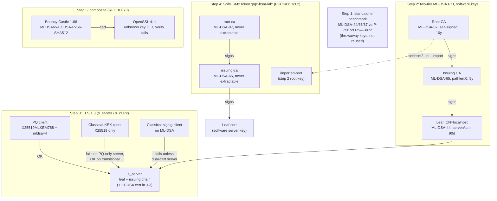

# pqc-hsm-lab

A reproducible, container-based test bench for migrating a PKI to **ML-DSA (FIPS 204)**. It covers key and certificate sizes, a two-tier CA, TLS 1.3 with hybrid key exchange, CA keys inside a PKCS#11 v3.2 HSM, and composite ML-DSA + ECDSA certificates.

Each of the five steps is a short shell script that runs against pinned, current open-source tooling and prints its own results. The full results, with limitations and migration implications for each step, are in **[RESULTS.md](RESULTS.md)**.

> **Scope.** This is a self-directed research project, built to work through a post-quantum PKI migration end to end on real tooling. It is a lab, not production software: keys are unencrypted, the HSM is SoftHSM2 (software only), and timings come from a single laptop.

## Key findings

| Area | Result |
|---|---|
| Sizes | An ML-DSA-65 certificate is about 15× larger than ECDSA P-256. A full ML-DSA TLS chain is 11.9 KB, compared with about 0.8 KB for ECDSA. |
| Performance | On OpenSSL 4.1, ML-DSA-44 verifies faster than ECDSA P-256, and ML-DSA signs 6–11× faster than RSA-3072. OpenSSL 4.1 is 2–3× faster than 3.5 on the same CPU. Size, not CPU, is the real cost. |
| TLS 1.3 | Hybrid X25519MLKEM768 key exchange works out of the box and falls back gracefully. ML-DSA authentication adds about 15 KB per handshake, and classical clients (browsers included) need a second, classical certificate. |
| HSM (PKCS#11 v3.2) | A full ML-DSA CA runs with both CA keys inside the token, but only with SoftHSM2 built from unreleased source. Two current PKCS#11 3.2 implementations still disagree on the key-generation template. |
| Composite (RFC 10073) | Bouncy Castle implements composite certificates; OpenSSL 4.1 cannot parse them. Composite certificates hedge against a weak ML-DSA but do not provide backward compatibility. |

## Quick start

Requirements: Docker with Compose v2, and `make` (optional). Tested on Arch Linux, bare metal (x86_64), with Docker 29.9 and Compose 5.7.

```sh
make build    # first build compiles SoftHSM2 (~1.5 min on a recent laptop), cached afterwards
make all      # runs steps 1-5 in order; each step prints its results
```

| Command | Effect |
|---|---|
| `make step1` … `make step5` | Run a single step. Steps 3 and 4 use the CA from step 2. Each step wipes and rewrites its own `out/NN/` |
| `make bench` | Speed comparison, OpenSSL 4.1 vs 3.5, over 5 runs, reported as medians (about 10 min; `make bench RUNS=n` to change) |
| `make shell` | Interactive shell in the container |
| `make clean` | Delete `out/` and the images |

Without `make`, the equivalent is:

```sh
docker compose build
docker compose run --rm pqc-hsm-lab scripts/01-keys-bench.sh
```

The container runs as UID/GID 1000 so that files in `out/` belong to the host user. If your IDs differ, set them first: `export LAB_UID=$(id -u) LAB_GID=$(id -g)`.

## Steps

| Step | Script | What it does |
|---|---|---|
| 1 | [`01-keys-bench.sh`](scripts/01-keys-bench.sh) | Sizes and speed: ML-DSA-44/65/87 vs ECDSA P-256 vs RSA-3072 ([results](RESULTS.md#step-1-sizes-and-speed)) |
| 2 | [`02-ca.sh`](scripts/02-ca.sh) | Two-tier CA on ML-DSA: root (87), issuing CA (65), TLS leaf (44) ([results](RESULTS.md#step-2-two-tier-ca-on-ml-dsa)) |
| 3 | [`03-tls.sh`](scripts/03-tls.sh) | TLS 1.3 with the ML-DSA chain and X25519MLKEM768; behaviour of classical clients ([results](RESULTS.md#step-3-tls-13-with-ml-dsa-and-x25519mlkem768)) |
| 4 | [`04-hsm.sh`](scripts/04-hsm.sh) | The same CA with both CA keys in a SoftHSM2 token over PKCS#11 v3.2 (generate and import) ([results](RESULTS.md#step-4-ml-dsa-ca-keys-in-an-hsm-pkcs11-v32)) |
| 5 | [`05-composite.sh`](scripts/05-composite.sh) | Composite ML-DSA + ECDSA certificates with Bouncy Castle; OpenSSL interop ([results](RESULTS.md#step-5-composite-certificates)) |
| – | [`bench.sh`](scripts/bench.sh) | Repeats step 1's speed test on OpenSSL 4.1 and 3.5 and reports medians and ranges. Runs on the host |



## Stack

All versions are pinned. Verified 2026-11-17.

| Component | Version | Purpose |
|---|---|---|
| Base image | `archlinux:latest` pinned by digest; package repos pinned to the [Arch Linux Archive](https://archive.archlinux.org/) snapshot of 2026-11-10 | Current PQC and PKCS#11 packages; the snapshot makes rebuilds reproducible |
| OpenSSL | 4.1.0 | Native ML-DSA (x86_64-optimised since 4.1), ML-KEM, X25519MLKEM768 TLS group |
| SoftHSM2 | built from `main` at commit `7b9b2557` (reports 2.7.0) | Software PKCS#11 v3.2 token. ML-DSA is merged on `main` but not in any release yet |
| pkcs11-provider | 1.3.0 | Lets OpenSSL use keys held in a PKCS#11 token |
| OpenSC `pkcs11-tool` | 0.27.1 | Generic PKCS#11 CLI, used to inspect the token |
| OpenJDK + Bouncy Castle | 21.0.13 + 1.86 (SHA-256-pinned jars) | Composite ML-DSA, RFC 10073 (step 5) |
| Baseline image | `debian:trixie` pinned by digest, OpenSSL 3.5.7 | Speed comparison only (`make bench`) |

The [Dockerfile](Dockerfile) has two stages. The build stage compiles SoftHSM2 at the pinned commit with `--enable-mldsa`; configure fails if ML-DSA can't be built, rather than silently leaving it out. The runtime stage copies in only the compiled SoftHSM (to `/opt/softhsm`), so no compilers end up in the image. To test a newer SoftHSM commit: `docker compose build --build-arg SOFTHSM_COMMIT=<full sha>`.

## Repository layout

```
Dockerfile                       lab image: Arch + OpenSSL 4.1 + SoftHSM2 (built from source) + pkcs11-provider + JDK/BC
Dockerfile.baseline              Debian trixie + OpenSSL 3.5, speed baseline for make bench
docker-compose.yml, Makefile     build / run
scripts/01..05-*.sh              one script per step (run inside the container)
scripts/Composite.java           step 5 helper (single-file Java program, no build step)
scripts/bench.sh                 speed comparison (runs on the host, starts both containers)
RESULTS.md                       per step: what it does, results, limitations, migration implications, output files
out/                             generated at runtime, not committed
```

## Reproducibility

- Both images are pinned by digest. The Arch package repositories are pinned to a dated archive snapshot, so a rebuild installs the same package versions. The baseline installs Debian trixie's current `openssl` package, and `make bench` records the exact version.
- SoftHSM2 is built from a full commit hash, and the Bouncy Castle jars are verified by SHA-256 at build time.
- Sizes are deterministic, apart from a few bytes of ECDSA encoding variance. Timings depend on the host CPU and power state; see [step 1's limitations](RESULTS.md#limitations).
- The results in [RESULTS.md](RESULTS.md) come from a clean `--no-cache` build. The same functional results were obtained earlier on a different x86_64 host (WSL2).

## Security notice

All key material is for testing only. Private keys are unencrypted PEM files, the SoftHSM PIN is `1234`, and SoftHSM2 offers no hardware protection. Do not reuse any of it.

## License

[MIT](LICENSE). Third-party components installed in the images (OpenSSL, SoftHSM2, pkcs11-provider, OpenSC, OpenJDK, Bouncy Castle) are under their own licenses.
